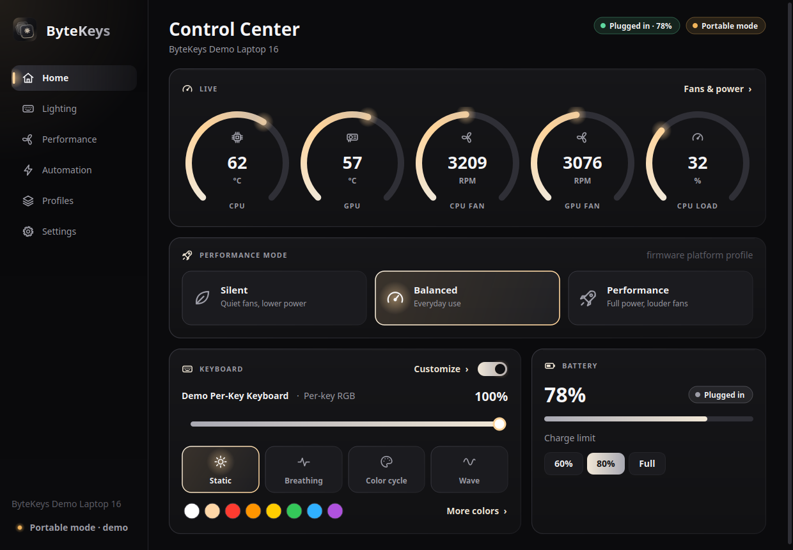
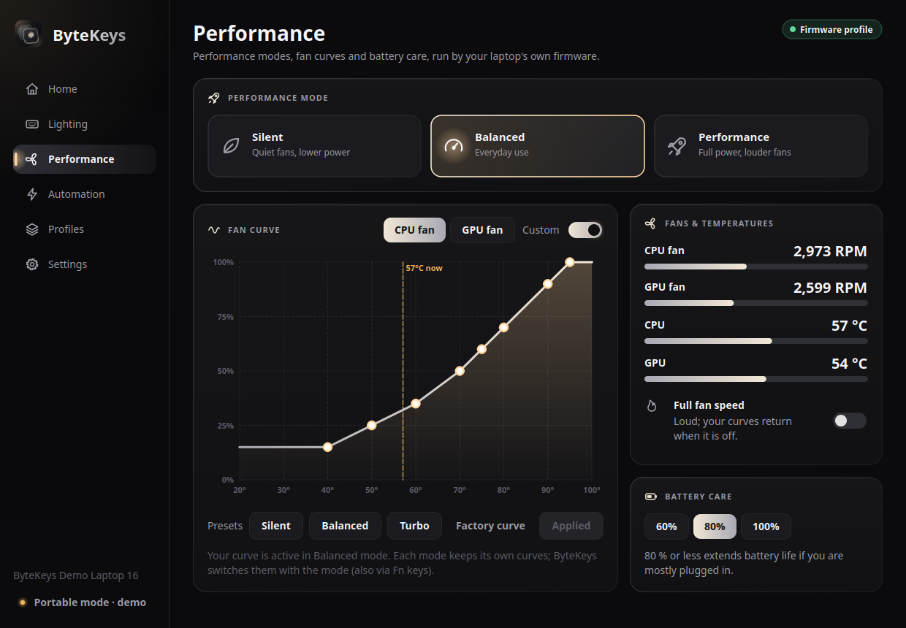
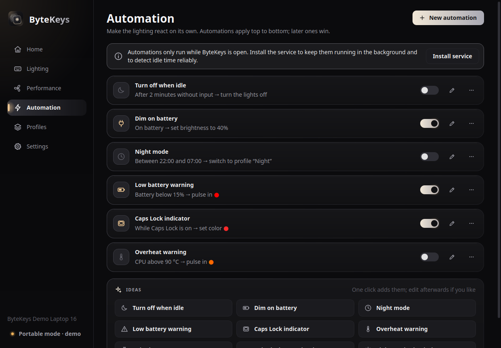
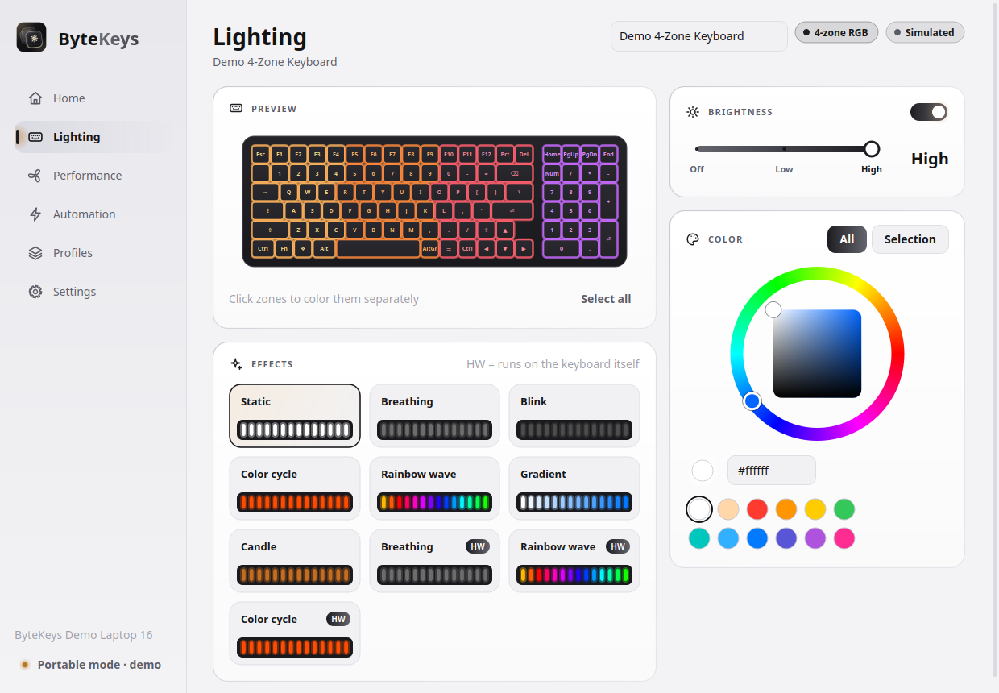

<p align="center">
  <picture>
    <source media="(prefers-color-scheme: light)" srcset="data/branding/bytekeys-banner-light.svg">
    
  </picture>
</p>

<p align="center">
  <b>Keyboard lighting, fans and performance modes for Linux laptops.</b><br>
  The control center your laptop's vendor app (Armoury Crate, NitroSense, OMEN Gaming Hub...) never shipped
  for Linux. Detected and configured automatically.
</p>

<p align="center">
  <a href="https://github.com/isthatdhruv/ByteKeys/releases/latest"></a>
  <a href="https://github.com/isthatdhruv/ByteKeys/actions/workflows/ci.yml"></a>
  <a href="LICENSE"></a>
</p>

<p align="center">
  
</p>

## Features

- **One control center.** Live CPU/GPU temperatures, fan speeds and battery, the performance mode, and
  the keyboard on a single screen, in a dark (or light) look.
- **Keyboard lighting for almost any laptop.** White backlights, single-zone, multi-zone and per-key RGB.
  ByteKeys finds keyboard lights exposed by the Linux kernel (ASUS, ThinkPad, Dell, System76,
  TUXEDO/Clevo, Apple, Framework, Chromebooks, Samsung, LG, Toshiba, Sony...), drives common USB lighting
  controllers itself (Lenovo Legion 4-zone, ITE 8291 per-key, ASUS ROG Aura, Dell G-series/Alienware, MSI
  3-zone, HID LampArray) and uses OpenRGB for everything else.
- **Modes and effects.** Static, Breathing, Color cycle, Wave, Strobe and more, with animated previews.
  The keyboard's own hardware modes are used when available, and software effects (Breathing, Blink,
  Color cycle, Wave, Gradient, Starlight, Reactive typing, Candle) work on every keyboard.
- **Zones and per-key colors.** Click or drag over keys in the live keyboard preview to color them.
- **Performance modes and fan control.** Switch Silent / Balanced / Performance (synced with your
  desktop's power settings), draw custom fan curves per mode on ASUS laptops (the firmware runs them, so
  a crash can never stop a fan), run the fans at full speed, and set a battery charge limit.
- **The launch key works.** The key that opens Armoury Crate, NitroSense, OMEN Gaming Hub or MSI Center on
  Windows opens ByteKeys instead, even when it is closed.
- **Automatic detection and setup.** It identifies your laptop model, picks the right drivers, creates
  sensible profiles, and tells you exactly what to install when a keyboard needs an extra kernel module.
- **Automations.** *When this happens, do that*: dim on battery, turn off when idle, a night schedule, low
  battery and overheat warnings, a Caps Lock indicator, color by CPU temperature or battery level, lights
  on in the dark...
- **Profiles** you can switch from the control center, the tray, the command line or an automation.
- **Restores everything** at boot and after sleep, and follows the laptop's own Fn keys.
- **Tray icon and a command line tool** (`bytekeys`) for scripts and keyboard shortcuts.
- **Safe by design.** A small root service does the hardware work; the control center runs as your user.
  Writes to keyboard flash memory are opt-in, fan curves are checked against safety limits, and
  dangerous controller commands are never sent.

<table>
  <tr>
    <td></td>
    <td></td>
  </tr>
  <tr>
    <td></td>
    <td></td>
  </tr>
</table>

## Install

Download the latest `.deb` or `.AppImage` from the
[releases page](https://github.com/isthatdhruv/ByteKeys/releases/latest).

**Debian, Ubuntu, Linux Mint, Pop!_OS, Zorin** (includes the background service):

```bash
sudo apt install ./bytekeys_1.1.0_all.deb
```

**Any distribution (AppImage):**

```bash
chmod +x ByteKeys-1.1.0-x86_64.AppImage
./ByteKeys-1.1.0-x86_64.AppImage
```

The AppImage starts in *portable mode*. Click **Install service** (Settings page or the banner) to unlock
colors, fan control and background automations; it asks for your password once and installs the service
to `/opt/bytekeys`. `./ByteKeys-*.AppImage cli status` runs the command line tool.

**From source** (Python 3.10+, PyQt6 or PySide6):

```bash
git clone https://github.com/isthatdhruv/ByteKeys.git && cd ByteKeys
make run            # control center from the source tree
sudo make install   # install to /usr/local and start the service
```

## Usage

Open **ByteKeys** from your applications menu, or press your laptop's launch key. The pages:

| Page | What it does |
|---|---|
| **Home** | Temperatures, fan speeds and CPU load, the performance mode, quick keyboard controls (power, brightness, mode, color) and the battery with its charge limit. |
| **Lighting** | Live keyboard preview, every hardware and software effect with its settings, brightness, a color wheel for the whole keyboard or selected zones/keys, and device options such as firmware timeouts or boot/sleep lighting. |
| **Performance** | Performance modes, a draggable fan curve per fan and mode (with presets), live fan speeds and temperatures, full fan speed and battery care. |
| **Automation** | Automations, applied top to bottom; a manual change wins until the automation stops applying. One-click ideas to start from. |
| **Profiles** | Saved looks for all keyboards. |
| **Settings** | This laptop, keyboards, the launch key, the background service, preferences and a diagnostic report. |

Command line examples:

```bash
bytekeys status                        # keyboards and their lighting
bytekeys brightness 60                 # or: up / down
bytekeys mode breathing                # static, breathing, cycle, wave, strobe
bytekeys color "#ff8800"               # whole keyboard
bytekeys color red green blue white    # one color per zone
bytekeys effect wave --speed 70
bytekeys profile apply Night
bytekeys perf performance              # performance mode: quiet, balanced, performance...
bytekeys fans                          # temperatures, fan speeds and fan curves
bytekeys fans boost on                 # full fan speed
bytekeys charge-limit 80               # stop charging at 80 %
bytekeys flash --color red --count 3   # e.g. from a notification script
bytekeys report                        # diagnostics for bug reports
```

Bind `bytekeys brightness up` / `bytekeys brightness down` / `bytekeys toggle` to keyboard shortcuts in
your desktop settings to control laptops whose Fn keys do not reach the backlight.

## Performance and fans

| Feature | Works on | Through |
|---|---|---|
| Performance modes | Laptops whose firmware offers an ACPI platform profile: ASUS, Lenovo, Dell, HP, Acer, Samsung, Huawei, System76, TUXEDO, ThinkPad... | `platform_profile`, via power-profiles-daemon when it runs |
| Custom fan curves (8 points per fan, per mode) | ASUS laptops with firmware fan curves (most TUF and ROG since 2021) | `asus-wmi` `asus_custom_fan_curve` |
| Full fan speed | ASUS laptops with "SPEC 8.3" fans | `asus-wmi` |
| Battery charge limit | ASUS, ThinkPad, Dell, Huawei, LG, Samsung, MSI, System76, Toshiba, Fujitsu and others with a charge threshold; Lenovo IdeaPad/Legion conservation mode | `charge_control_end_threshold`, `charge_types`, `conservation_mode` |
| Temperatures and fan speeds | Everything with hwmon sensors; NVIDIA GPUs through `nvidia-smi` without waking the GPU | hwmon |

ByteKeys only uses controls that the laptop's firmware runs itself and never drives fan PWM directly, so
a crash or a stopped service can never leave a fan off. Curves must keep the fans at 50 % or more from
80 °C and end at 70 % or more. The kernel forgets custom curves on every mode change, at boot and after
sleep; the service keeps them active. Details in
[docs/SUPPORTED_HARDWARE.md](docs/SUPPORTED_HARDWARE.md#performance-modes-fans-and-battery).

## Launch key

Most gaming laptops have a key that opens the vendor's app: Armoury Crate on ASUS TUF/ROG, NitroSense or
PredatorSense on Acer, OMEN Gaming Hub on HP, MSI Center on MSI, MyASUS on Zenbooks. ByteKeys knows the
key of your laptop and can learn any other special key (**Settings → Launch key → Detect key**).

- With the service running, the key brings ByteKeys to the front from anywhere.
- On GNOME (Ubuntu, Pop!_OS, Zorin...) and KDE Plasma, ByteKeys also adds a desktop shortcut, so the key
  starts ByteKeys when it is closed.
- The service watches only that one key. It never records what you type.

## Supported keyboard lighting

| Hardware | Through | Lighting | Status |
|---|---|---|---|
| ASUS TUF Gaming | kernel `asus-wmi` | RGB; Static, Breathing, Color cycle, Strobe, Pulse; boot/awake/sleep lighting | Tested |
| ASUS ROG (USB Aura `0b05:1854/1866/1869/19b6/1a30`) | built-in driver | RGB; Breathing, Color cycle, Wave, Pulse | Experimental |
| Lenovo Legion, LOQ, IdeaPad Gaming 4-zone (`048d:c955`–`c995`) | built-in driver | 4 zones; Breathing, Color cycle, Wave | Experimental |
| Clevo, Tongfang, XMG, Eluktronics, TUXEDO per-key (ITE 8291 `048d:6004/6006/600a/600b/ce00`) | built-in driver | per-key; 9 hardware effects | Experimental |
| TUXEDO, Clevo, Uniwill with [tuxedo-drivers](https://github.com/tuxedocomputers/tuxedo-drivers) | kernel | 1-zone, 3-zone or per-key; hardware modes | Supported |
| System76 | kernel `system76_acpi` | RGB or white | Supported |
| Dell G15/G16, Alienware (AW-ELC `187c:0550/0551`) | built-in driver | 4 zones; Breathing | Experimental |
| Older Alienware | kernel `alienware-wmi` | zones | Supported |
| HP Omen / Victus | [omen-rgb-keyboard](https://github.com/alessandromrc/omen-rgb-keyboard) or hp-omen module | 4 zones; animations | Supported |
| Acer Predator / Nitro | [facer module](https://github.com/JafarAkhondali/acer-predator-turbo-and-rgb-keyboard-linux-module) | 4 zones; effects | Supported |
| MSI SteelSeries 3-zone (`1770:ff00`) | built-in driver | 3 zones | Experimental |
| HID LampArray keyboards (Windows Dynamic Lighting) | built-in driver | per-lamp | Experimental |
| ThinkPad, IdeaPad, Yoga, Dell, Apple, Framework, Chromebook, Samsung, LG gram, Toshiba, Sony, MSI (msi-ec), Bitland... | kernel | white, with levels and firmware timeouts where available | Supported |
| MSI per-key, Razer, Gigabyte/AORUS, Legion per-key and hundreds more | [OpenRGB](https://openrgb.org) SDK (`openrgb --server`) | whatever OpenRGB supports | Supported |

*Experimental* drivers implement documented protocols (see [docs/SUPPORTED_HARDWARE.md](docs/SUPPORTED_HARDWARE.md))
but have not been confirmed on that hardware yet. Reports are very welcome! If your keyboard is not
detected, open **Settings → Copy report** and
[open an issue](https://github.com/isthatdhruv/ByteKeys/issues/new?template=device_support.yml).

## How it works

```
 bytekeys-gui ─┐                             ┌─ kernel LED drivers (/sys/class/leds, WMI zones)
 bytekeys CLI ─┼─ /run/bytekeys ─ bytekeysd ─┼─ USB HID controllers (/dev/hidraw*)
 tray icon ────┘    (JSON RPC)     (root)    ├─ platform profile, hwmon fan curves, battery
                                             └─ OpenRGB SDK server (TCP 6742)
```

`bytekeysd` owns the hardware: it applies lighting, renders software effects, evaluates automations,
switches performance modes, keeps fan curves and the charge limit active, restores everything after boot
and resume, and watches for keyboards being added. Anyone may read its state, but only root, members of
the `bytekeys` group and the user at the active local session may change it. To detect idle time and run
the Reactive effect it notes *when* an input event happened; the only key it ever looks at is the
configured launch key. Without the service, the GUI and CLI run the same engine in-process (portable
mode) with whatever the current user may access. More in [docs/ARCHITECTURE.md](docs/ARCHITECTURE.md).

## Contributing

ByteKeys is written in Python (standard library only, plus Qt for the control center). Adding a keyboard
is usually one small driver class; see [docs/ADDING_DEVICES.md](docs/ADDING_DEVICES.md) and
[CONTRIBUTING.md](CONTRIBUTING.md).

```bash
make test       # unit tests (fake /sys trees, simulated keyboards and fans, protocol byte checks, GUI)
make demo       # control center with simulated keyboards and fans
make deb        # dist/bytekeys_<version>_all.deb
make appimage   # dist/ByteKeys-<version>-x86_64.AppImage
```

## Credits

The USB protocols were implemented from the documentation and source of
[OpenRGB](https://gitlab.com/CalcProgrammer1/OpenRGB),
[L5P-Keyboard-RGB](https://github.com/4JX/L5P-Keyboard-RGB),
[LegionAura](https://github.com/Nivedck/LegionAura),
[ite8291r3-ctl](https://github.com/pobrn/ite8291r3-ctl),
[tuxedo-drivers](https://github.com/tuxedocomputers/tuxedo-drivers),
[asusctl](https://gitlab.com/asus-linux/asusctl),
[alienfx-tools](https://github.com/T-Troll/alienfx-tools),
[awelc-ctl](https://github.com/ahpqmiranda/awelc-ctl) and
[MSIKLM](https://github.com/Gibtnix/MSIKLM). The fan curve handling follows how
[asusctl](https://gitlab.com/asus-linux/asusctl) works with the asus-wmi driver. Thank you!

## License

ByteKeys is free software, released under the [GNU General Public License v3.0 or later](LICENSE).
