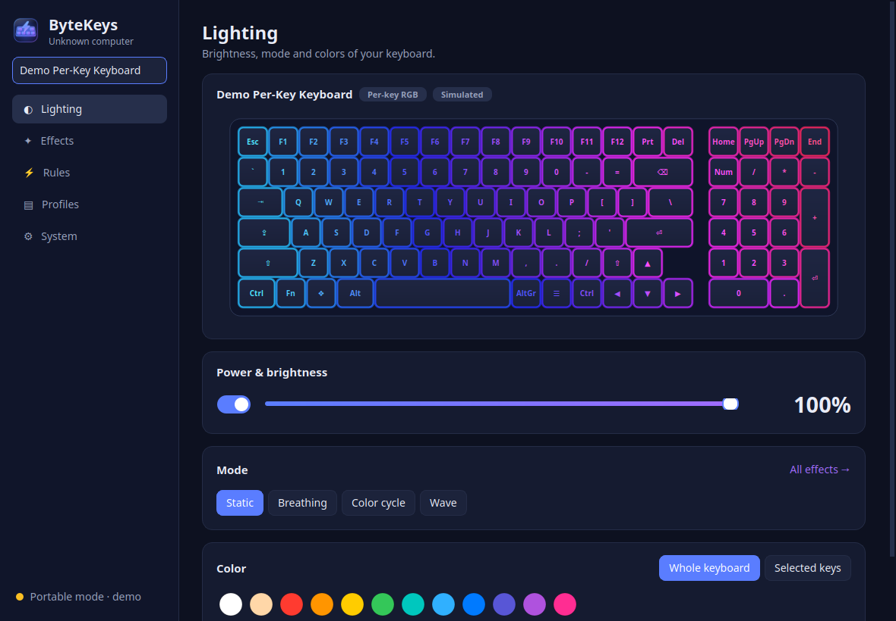
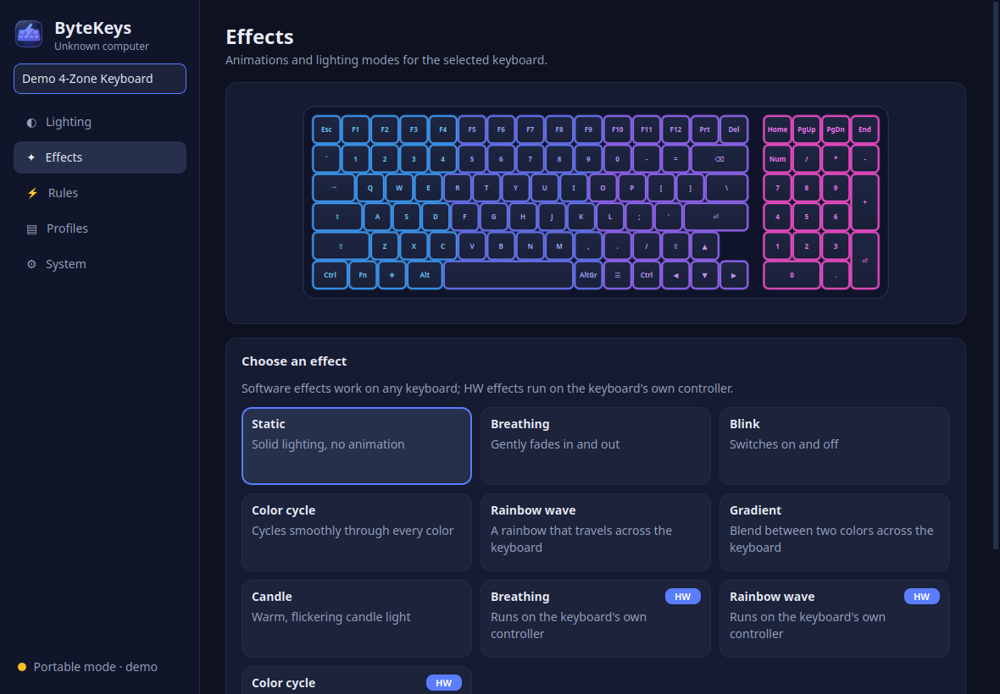
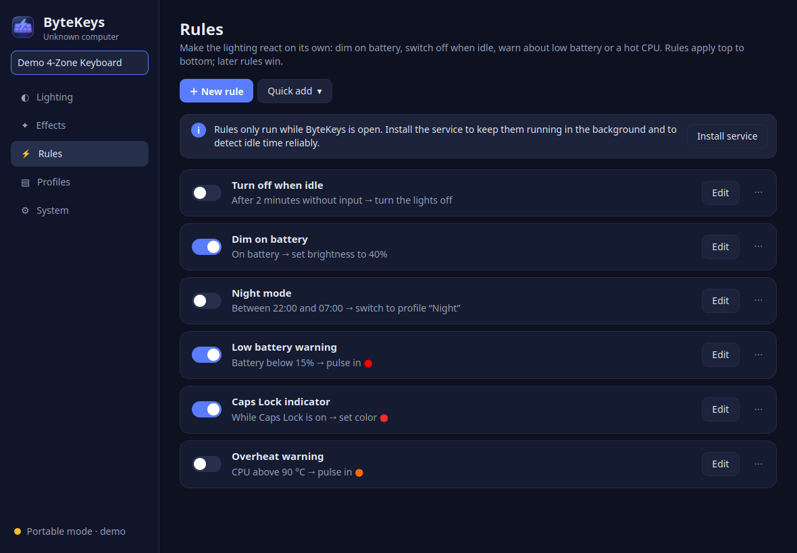
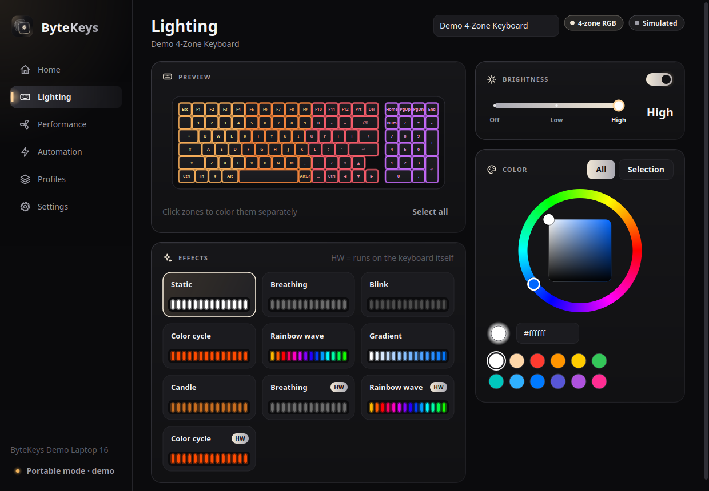
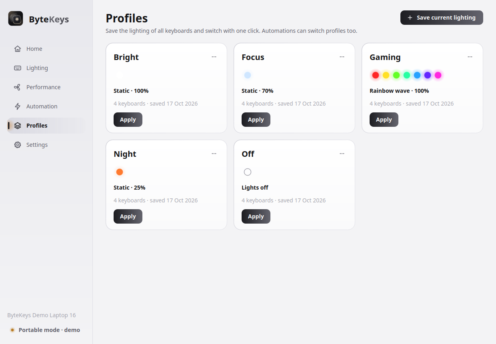

<p align="center">
  <picture>
    <source media="(prefers-color-scheme: light)" srcset="data/branding/bytekeys-banner-light.svg">
    
  </picture>
</p>

<p align="center">
  <b>Keyboard backlight and RGB lighting control for Linux laptops.</b><br>
  White backlights, single-zone, multi-zone and per-key RGB. Detected and configured automatically.
</p>

<p align="center">
  <a href="https://github.com/isthatdhruv/ByteKeys/releases/latest"></a>
  <a href="https://github.com/isthatdhruv/ByteKeys/actions/workflows/ci.yml"></a>
  <a href="LICENSE"></a>
</p>

<p align="center">
  
</p>

## Features

- **Works with almost any laptop.** ByteKeys finds keyboard lights exposed by the Linux kernel (ASUS,
  ThinkPad, Dell, System76, TUXEDO/Clevo, Apple, Framework, Chromebooks, Samsung, LG, Toshiba, Sony...),
  drives common USB lighting controllers itself (Lenovo Legion 4-zone, ITE 8291 per-key, ASUS ROG Aura,
  Dell G-series/Alienware, MSI 3-zone, HID LampArray) and uses OpenRGB for everything else.
- **Automatic detection and setup.** It identifies your laptop model, picks the right driver, creates
  sensible profiles, and tells you exactly what to install when a keyboard needs an extra kernel module.
- **Modes and effects.** Static, Breathing, Color cycle, Wave, Strobe and more. The keyboard's own
  hardware modes are used when available, and software effects (Breathing, Blink, Color cycle, Wave,
  Gradient, Starlight, Reactive typing, Candle) work on every keyboard, even plain white ones.
- **Zones and per-key colors.** Click or drag over keys in the live keyboard preview to color them.
- **Rules (custom functions).** *When this happens, do that*: dim on battery, turn off when idle, a night
  schedule, low battery and overheat warnings, a Caps Lock indicator, color by CPU temperature or battery
  level, lights on in the dark (ambient light sensor)...
- **Profiles** you can switch from the control panel, the tray, the command line or a rule.
- **Restores your lighting** at boot and after sleep, and follows the laptop's own Fn brightness keys.
- **Tray icon and a command line tool** (`bytekeys`) for scripts and keyboard shortcuts.
- **Safe by design.** A small root service does the hardware work; the control panel runs as your user.
  Writes to keyboard flash memory are opt-in, and dangerous controller commands are never sent.

<table>
  <tr>
    <td></td>
    <td></td>
  </tr>
  <tr>
    <td></td>
    <td></td>
  </tr>
</table>

## Install

Download the latest `.deb` or `.AppImage` from the
[releases page](https://github.com/isthatdhruv/ByteKeys/releases/latest).

**Debian, Ubuntu, Linux Mint, Pop!_OS, Zorin** (includes the background service):

```bash
sudo apt install ./bytekeys_1.0.0_all.deb
```

**Any distribution (AppImage):**

```bash
chmod +x ByteKeys-1.0.0-x86_64.AppImage
./ByteKeys-1.0.0-x86_64.AppImage
```

The AppImage starts in *portable mode*. Click **Install service** (System page or the banner) to unlock
color control and background rules; it asks for your password once and installs the service to
`/opt/bytekeys`. `./ByteKeys-*.AppImage cli status` runs the command line tool.

**From source** (Python 3.10+, PyQt6 or PySide6):

```bash
git clone https://github.com/isthatdhruv/ByteKeys.git && cd ByteKeys
make run            # control panel from the source tree
sudo make install   # install to /usr/local and start the service
```

## Usage

Open **ByteKeys** from your applications menu. The pages:

| Page | What it does |
|---|---|
| **Lighting** | Live keyboard preview, power and brightness, one-click modes (Static / Breathing / Color cycle / Wave / Strobe), colors for the whole keyboard or selected zones/keys, and device options such as firmware timeouts or boot/sleep lighting. |
| **Effects** | Every software and hardware effect your keyboard supports, with speed, direction and colors. |
| **Rules** | Automations. Rules apply top to bottom; a manual change wins until the rule stops applying. |
| **Profiles** | Saved looks for all keyboards. |
| **System** | Detected hardware, hints, the service, preferences and a diagnostic report. |

Command line examples:

```bash
bytekeys status                        # keyboards and their lighting
bytekeys brightness 60                 # or: up / down
bytekeys mode breathing                # static, breathing, cycle, wave, strobe
bytekeys color "#ff8800"               # whole keyboard
bytekeys color red green blue white    # one color per zone
bytekeys effect wave --speed 70
bytekeys profile apply Night
bytekeys rules enable battery-dim
bytekeys flash --color red --count 3   # e.g. from a notification script
bytekeys report                        # diagnostics for bug reports
```

Bind `bytekeys brightness up` / `bytekeys brightness down` / `bytekeys toggle` to keyboard shortcuts in
your desktop settings to control laptops whose Fn keys do not reach the backlight.

## Supported hardware

| Hardware | Through | Lighting | Status |
|---|---|---|---|
| ASUS TUF Gaming | kernel `asus-wmi` | RGB; Static, Breathing, Color cycle, Strobe, Pulse; boot/awake/sleep lighting | Tested |
| ASUS ROG (USB Aura `0b05:1854/1866/1869/19b6/1a30`) | built-in driver | RGB; Breathing, Color cycle, Wave, Pulse | Experimental |
| Lenovo Legion, LOQ, IdeaPad Gaming 4-zone (`048d:c955`–`c995`) | built-in driver | 4 zones; Breathing, Color cycle, Wave | Experimental |
| Clevo, Tongfang, XMG, Eluktronics, TUXEDO per-key (ITE 8291 `048d:6004/6006/600a/600b/ce00`) | built-in driver | per-key; 9 hardware effects | Experimental |
| TUXEDO, Clevo, Uniwill with [tuxedo-drivers](https://github.com/tuxedocomputers/tuxedo-drivers) | kernel | 1-zone, 3-zone or per-key; hardware modes | Supported |
| System76 | kernel `system76_acpi` | RGB or white | Supported |
| Dell G15/G16, Alienware (AW-ELC `187c:0550/0551`) | built-in driver | 4 zones; Breathing | Experimental |
| Older Alienware | kernel `alienware-wmi` | zones | Supported |
| HP Omen / Victus | [omen-rgb-keyboard](https://github.com/alessandromrc/omen-rgb-keyboard) or hp-omen module | 4 zones; animations | Supported |
| Acer Predator / Nitro | [facer module](https://github.com/JafarAkhondali/acer-predator-turbo-and-rgb-keyboard-linux-module) | 4 zones; effects | Supported |
| MSI SteelSeries 3-zone (`1770:ff00`) | built-in driver | 3 zones | Experimental |
| HID LampArray keyboards (Windows Dynamic Lighting) | built-in driver | per-lamp | Experimental |
| ThinkPad, IdeaPad, Yoga, Dell, Apple, Framework, Chromebook, Samsung, LG gram, Toshiba, Sony, MSI (msi-ec), Bitland... | kernel | white, with levels and firmware timeouts where available | Supported |
| MSI per-key, Razer, Gigabyte/AORUS, Legion per-key and hundreds more | [OpenRGB](https://openrgb.org) SDK (`openrgb --server`) | whatever OpenRGB supports | Supported |

*Experimental* drivers implement documented protocols (see [docs/SUPPORTED_HARDWARE.md](docs/SUPPORTED_HARDWARE.md))
but have not been confirmed on that hardware yet. Reports are very welcome! If your keyboard is not
detected, open **System → Copy report** and
[open an issue](https://github.com/isthatdhruv/ByteKeys/issues/new?template=device_support.yml).

## How it works

```
 bytekeys-gui ─┐                      ┌─ kernel LED drivers (/sys/class/leds, WMI zones)
 bytekeys CLI ─┼─ /run/bytekeys ─ bytekeysd ─┼─ USB HID controllers (/dev/hidraw*)
 tray icon ────┘    (JSON RPC)     (root)     └─ OpenRGB SDK server (TCP 6742)
```

`bytekeysd` owns the hardware: it applies lighting, renders software effects, evaluates rules, restores
your look after boot and resume, and watches for keyboards being added. Anyone may read its state, but
only root, members of the `bytekeys` group and the user at the active local session may change it. To
detect idle time and run the Reactive effect it notes *when* an input event happened, never which key it
was. Without the service, the GUI and CLI run the same engine in-process (portable mode) with whatever the
current user may access. More in [docs/ARCHITECTURE.md](docs/ARCHITECTURE.md).

## Contributing

ByteKeys is written in Python (standard library only, plus Qt for the control panel). Adding a keyboard is
usually one small driver class; see [docs/ADDING_DEVICES.md](docs/ADDING_DEVICES.md) and
[CONTRIBUTING.md](CONTRIBUTING.md).

```bash
make test       # unit tests (fake /sys trees, simulated keyboards, protocol byte checks)
make demo       # control panel with simulated keyboards
make deb        # dist/bytekeys_<version>_all.deb
make appimage   # dist/ByteKeys-<version>-x86_64.AppImage
```

## Credits

The USB protocols were implemented from the documentation and source of
[OpenRGB](https://gitlab.com/CalcProgrammer1/OpenRGB),
[L5P-Keyboard-RGB](https://github.com/4JX/L5P-Keyboard-RGB),
[LegionAura](https://github.com/Nivedck/LegionAura),
[ite8291r3-ctl](https://github.com/pobrn/ite8291r3-ctl),
[tuxedo-drivers](https://github.com/tuxedocomputers/tuxedo-drivers),
[asusctl](https://gitlab.com/asus-linux/asusctl),
[alienfx-tools](https://github.com/T-Troll/alienfx-tools),
[awelc-ctl](https://github.com/ahpqmiranda/awelc-ctl) and
[MSIKLM](https://github.com/Gibtnix/MSIKLM). Thank you!

## License

ByteKeys is free software, released under the [GNU General Public License v3.0 or later](LICENSE).
